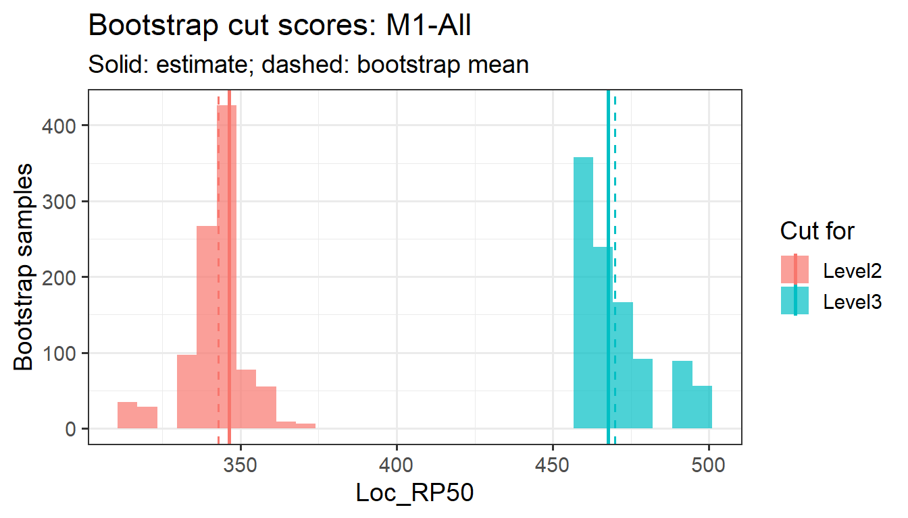

# Bootstrapping cut scores

An ESS cut score depends on which items happen to be on the test. A
different set of items measuring the same content, aligned by the same
panel, would give somewhat different cuts.
[`bootstrapping()`](https://sooyongl.github.io/emss/reference/bootstrapping.ESS.md)
estimates that variability by resampling the items. The notation follows
[How embedded standard setting
works](https://sooyongl.github.io/emss/articles/ess-method.md).

## 1 The study

The simulated study from [Getting
started](https://sooyongl.github.io/emss/articles/getting-started.md):

``` r
set.seed(7)
sim <- genFakeDataSet(ngca = 3, ntable = 2, npanelist = 4, cor_val = 0.7, nlevel = 3,
                      sdinp = 1, ecinp = 0, n = 40, 300, 500,
                      domains = c("Number", "Algebra", "Geometry"))
res <- emstans(data = sim, location = "Loc_RP50")
extract(res, "cutscore")
#> $`M1-All`
#> Level2 Level3 
#>  346.3  467.7 
#> 
#> $`M2-All`
#> Level2 Level3 
#>  366.6  469.6 
#> 
#> $`M3-All`
#> Level2 Level3 
#>  406.8  503.3
```

## 2 The item bootstrap

A unit’s modal result is a function of its \\n\\ items, each an (item
location, modal aligned level) pair:

\\ \hat c_k = T_k\big( (b_1, a_1), \dots, (b_n, a_n) \big), \qquad k =
2, \dots, K, \\

where \\T_k\\ is the ESS rule: the minimum of the ESS-Weight or
ESS-Count profile with its tie-breaks. The bootstrap (Efron &
Tibshirani, 1993) treats the items as a sample from the population of
items that could have been written for the test, and approximates the
sampling distribution of \\\hat c_k\\ by applying the same rule to
samples drawn from the items themselves:

1.  Draw \\n\\ items with replacement, keeping each item’s location and
    modal level together: \\(b^\*\_i, a^\*\_i)\\, \\i = 1, \dots, n\\.
2.  Order the sampled items by location and estimate the cuts, \\\hat
    c^{\*}\_{kb} = T_k\big((b^\*\_1, a^\*\_1), \dots, (b^\*\_n,
    a^\*\_n)\big)\\, with the same criterion as the original fit.
3.  Repeat for \\b = 1, \dots, B\\.

An item drawn \\m\\ times counts \\m\\ times in the profiles, like \\m\\
items at the same location with the same alignment.
[`bootstrapping()`](https://sooyongl.github.io/emss/reference/bootstrapping.ESS.md)
reports, for each cut level,

\\ \bar c^{\*}\_k = \frac1B \sum_b \hat c^{\*}\_{kb}, \qquad
\widehat{\mathrm{SE}}\_k = \sqrt{\frac{1}{B-1} \sum_b \big(\hat
c^{\*}\_{kb} - \bar c^{\*}\_k\big)^2}, \\

the median, minimum and maximum, and the 2.5% and 97.5% percentiles,
which form a 95% percentile interval. \\\bar c^{\*}\_k - \hat c_k\\
estimates the bias of the cut.

The bootstrap takes the modal alignments, the item locations and the SD
as fixed. It captures the variability due to the choice of items, not
the variability among panelists (see [Variability across
panelists](#sec-panelists)), and not the estimation error in the item
locations.

## 3 Running it

[`bootstrapping()`](https://sooyongl.github.io/emss/reference/bootstrapping.ESS.md)
works on one unit at a time. `seed` makes the draws reproducible.

``` r
boot <- bootstrapping(res, unit = "M1-All", n = 1000, seed = 1)
boot
#> Bootstrap of modal cut scores for M1-All (1000 samples, item locations, exact minimum)
#>  cut_level    n  mean     sd median   min   max  q2.5 q97.5 estimate
#>     Level2 1000 342.9  9.664  346.3 313.9 372.4 316.9 359.0    346.3
#>     Level3 1000 469.9 12.448  467.7 458.4 497.8 458.4 497.1    467.7
```

[`extract()`](https://sooyongl.github.io/emss/reference/extract.ESS.md)
returns the draws, the summary and a plot.
[`report()`](https://sooyongl.github.io/emss/reference/report.ESS.md)
builds an HTML report of them.

``` r
draws <- extract(boot, "draws")
head(draws)
#>   rep cut_level cut_score inconsistency
#> 1   1    Level2     359.0          42.1
#> 2   1    Level3     469.4          84.8
#> 3   2    Level2     352.7          12.6
#> 4   2    Level3     458.4          36.0
#> 5   3    Level2     348.7          45.1
#> 6   3    Level3     481.2          40.9
extract(boot, "plot")
```



``` r
report(boot)
```

## 4 Reading the results

**The draws are discrete.** With `grid = "items"`, every bootstrap cut
is an item location, so the histogram has gaps and the percentile
interval runs from one item location to another. The SE is a better
single summary than the interval width when there are few items.

**Where the cut lies matters.** The ESS-Weight cut for level \\k\\ is
the location of item \\n\_{\<k}\\ or \\n\_{\<k} + 1\\ in booklet order
(see [ESS-Weight is a quantile of the item
locations](https://sooyongl.github.io/emss/articles/ess-method.html#sec-quantile)).
In a bootstrap sample, the number of items aligned below level \\k\\
varies around \\n\_{\<k}\\, so the bootstrap cut behaves like a sample
quantile of the item locations at proportion \\\pi_k = n\_{\<k}/n\\. For
a quantile, the large-sample standard error is approximately

\\ \mathrm{SE}\_k \approx \frac{1}{g(c_k)} \sqrt{\frac{\pi_k (1 -
\pi_k)}{n}}, \\

where \\g\\ is the density of the item locations near the cut. A cut in
a region of the scale with few items is uncertain, and adding items near
a cut makes it more precise.

**Cuts near the end of the item range are skewed.** A cut can only fall
on an item location, so its bootstrap distribution is bounded by the
easiest and hardest items. A cut near either end has a lopsided
distribution, and its bootstrap mean is pulled away from the estimate,
toward the middle of the item range.

**ESS-Count often varies more.** Its profile is a walk with possibly
several separated minima, so small changes in the items can move the cut
from one minimum to another:

``` r
res_c <- emstans(data = sim, location = "Loc_RP50", method = "count")
boot_c <- bootstrapping(res_c, unit = "M1-All", n = 1000, seed = 1)
rbind(weight = extract(boot, "summary")$sd, count = extract(boot_c, "summary")$sd)
#>          [,1]  [,2]
#> weight  9.664 12.45
#> count  10.821 13.59
```

## 5 The jittered-grid bootstrap

Earlier versions of EmStanS used a different estimator in each bootstrap
sample. It remains available with `grid = "jittered"`:

1.  Resample the items as above.
2.  Build a grid of candidate cuts from the lowest to the highest
    sampled location with step \\s\\ (\\s = 0.1\\ when the location
    range is under 10, otherwise \\s = 1\\). Move each grid point by a
    uniform random amount: \\g_t = b^\*\_{(1)} + (t - 1)s - U_t\\, \\U_t
    \sim \mathrm{Uniform}(-s, s)\\. One grid is shared by all cut
    levels.
3.  Evaluate the profile (\\W_k\\ or \\C_k\\) at every grid point, fit a
    Gaussian GAM to it (`mgcv::gam(y ~ s(g, k = 10))`, fewer basis
    functions for short grids; Wood, 2017), and take the minimum of the
    fitted curve over \\n\\ equally spaced points.

``` r
boot_j <- bootstrapping(res, unit = "M1-All", n = 200, seed = 1, grid = "jittered")
boot_j
#> Bootstrap of modal cut scores for M1-All (200 samples, jittered grid, smoothed minimum)
#>  cut_level   n  mean     sd median   min   max q2.5 q97.5 estimate
#>     Level2 200 340.6  8.107  341.9 312.9 358.2  322 352.3    346.3
#>     Level3 200 472.6 13.060  469.0 443.5 499.6  453 499.2    467.7
```

The jittered grid estimates a smoothed minimum that need not be an item
location, so its draws are not discrete. But it is a different estimator
from the one
[`emstans()`](https://sooyongl.github.io/emss/reference/emstans.md)
uses: its draws describe a smoothed cut, not the reported one, and their
centre can differ from the reported cut. Use the default
`grid = "items"` to describe the uncertainty of the cut scores emss
reports. Use `"jittered"` to reproduce earlier EmStanS results.

If the original fit used `smooth = TRUE`, the default bootstrap also
uses the smoothed minimum in every sample, so it matches the original
estimator.

## 6 Variability across panelists

The bootstrap above holds the panel fixed. A complementary summary of
how much the cut depends on the panelists is the spread of the
panelists’ own cuts. If the \\J\\ panelists are treated as a random
sample of qualified panelists, the standard error of the average
panelist cut is

\\ \mathrm{SE}(\bar c_k) = \frac{s_k}{\sqrt{J}}, \\

where \\s_k\\ is the SD of the panelist cuts:

``` r
pan <- extract(res, "individual")$panelist
pan <- pan[pan$unit == "M1-All", ]
aggregate(cut_score ~ cut_level, pan, function(x) c(mean = mean(x), sd = sd(x),
                                                    se = sd(x) / sqrt(length(x))))
#>   cut_level cut_score.mean cut_score.sd cut_score.se
#> 1    Level2        347.587       13.289        4.698
#> 2    Level3        455.900       31.191       11.028
```

Panelists who discussed their alignments at the same table are not
independent, so this standard error is optimistic when tables differ.
With enough tables, the SD of the table-level cuts divided by the square
root of the number of tables is a more conservative alternative.

## 7 References

Efron, B., & Tibshirani, R. J. (1993). *An introduction to the
bootstrap*. Chapman and Hall/CRC.

Wood, S. N. (2017). *Generalized additive models: An introduction with
R* (2nd ed.). Chapman and Hall/CRC.
