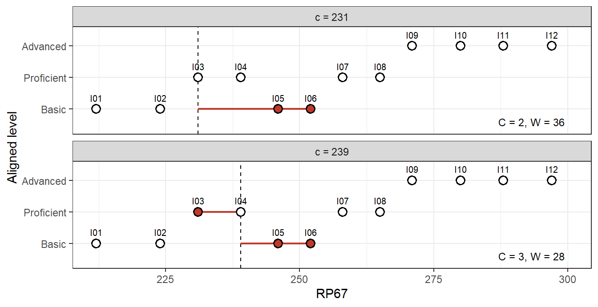
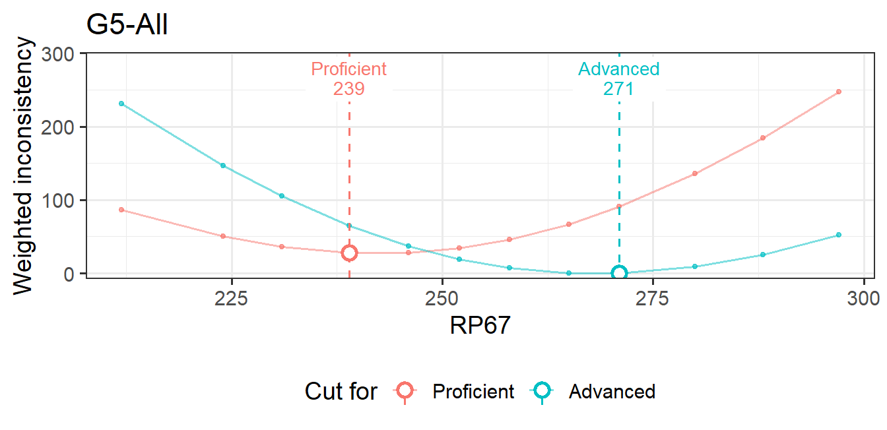
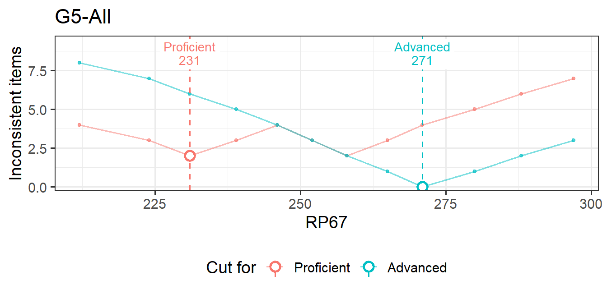

# How embedded standard setting works

This article explains what emss computes and why. It works through a
12-item example by hand, checks every hand calculation against emss, and
then states the mathematical properties of the two criteria, ESS-Count
and ESS-Weight, with short proofs. For day-to-day use of the package,
start with [Getting
started](https://sooyongl.github.io/emss/articles/getting-started.md).
[Manual cut
scores](https://sooyongl.github.io/emss/articles/manual-cut-scores.md)
and the
[bootstrap](https://sooyongl.github.io/emss/articles/bootstrapping.md)
have their own articles.

## 1 The idea

In **embedded standard setting** (ESS; Lewis & Cook, 2020), content
experts align each test item to the performance level descriptor (PLD),
also called the achievement level descriptor (ALD), whose knowledge and
skills the item calls for. The alignment is part of item development
rather than a separate standard-setting meeting, so the performance
standards are *embedded* in the test’s design. ESS has been used in K-12
assessment and in credentialing (Lewis, Graw, & Baker, 2024).

Each item also has a **location** on the reporting scale, typically a
response-probability location such as RP67: the scale score at which an
examinee has a 67% chance of answering the item correctly. When the
descriptors and the scale tell the same story, items aligned to higher
levels sit higher on the scale. A cut score for a level is then placed
where the order of the items on the scale agrees best with their aligned
levels:

- items aligned **at or above** the level should be located **at or
  above** its cut score, and
- items aligned **below** the level should be located **below** it.

An item on the wrong side of a cut is **inconsistent** with that cut.
ESS places every cut where inconsistency is smallest. The two versions
differ only in how they measure it:

- **ESS-Count** counts the inconsistent items.
- **ESS-Weight** adds up how far the inconsistent items are from the cut
  on the location scale.

Lewis, Lee and Choi (2021) compared the two algorithms.

## 2 Notation

The analysis is carried out separately for each **unit**: one grade, one
rating round and one item subset (all items, or one content domain; see
[Analysis units](#sec-units)). Within a unit:

| Symbol | Meaning |
|:---|:---|
| \\n\\ | number of items |
| \\b_i\\ | location of item \\i\\ (the column named by `location`, such as RP67) |
| \\b\_{(1)} \le \dots \le b\_{(n)}\\ | locations in increasing order; the position \\p\\ of an item in this order is its **page** in the ordered item booklet |
| \\K\\ | number of performance levels, ordered \\1 \< 2 \< \dots \< K\\ |
| \\a\_{ij}\\ | level panelist \\j\\ aligned item \\i\\ to (\\j = 1, \dots, J\\) |
| \\a_i\\ | the item’s aligned level used for the cut (one panelist’s \\a\_{ij}\\, or the modal level across panelists) |
| \\k\\ | a cut level, \\k = 2, \dots, K\\: the cut \\c_k\\ is the lowest score in level \\k\\ |
| \\U_k = \\i : a_i \ge k\\\\ | items aligned at or above level \\k\\ (“upper” items) |
| \\L_k = \\i : a_i \< k\\\\ | items aligned below level \\k\\ (“lower” items); \\n\_{\<k} = \lvert L_k \rvert\\ |
| \\\sigma\\ | the grade’s SD; weights are divided by it (default 1) |
| \\o_i\\ | empirical level of item \\i\\, implied by the cut scores |

Items with the same location are ordered by `Order_of_Difficulty` and
then by input order. This affects only the page numbers shown, not the
cut scores.

## 3 A worked example

Twelve items in grade “G5” have RP67 locations between 212 and 297.
Three panelists aligned each item to one of three levels: Basic,
Proficient and Advanced.

``` r
items <- data.frame(
  Grade   = "G5",
  Item_ID = sprintf("I%02d", 1:12),
  RP67    = c(212, 224, 231, 239, 246, 252, 258, 265, 271, 280, 288, 297)
)
labels <- c("Basic", "Proficient", "Advanced")
alignments <- list(                       # 1 = Basic, 2 = Proficient, 3 = Advanced
  P1 = c(1, 1, 2, 2, 1, 2, 2, 2, 3, 3, 3, 3),
  P2 = c(1, 1, 1, 2, 1, 1, 2, 3, 3, 2, 3, 3),
  P3 = c(1, 2, 3, 1, 2, 1, 2, 2, 2, 3, 3, 3)
)
ratings <- do.call(rbind, lapply(names(alignments), function(p) data.frame(
  Grade = "G5", Table = "T1", Panelist = p, Item_ID = items$Item_ID,
  ALD = labels[alignments[[p]]])))
head(ratings, 3)
#>   Grade Table Panelist Item_ID        ALD
#> 1    G5    T1       P1     I01      Basic
#> 2    G5    T1       P1     I02      Basic
#> 3    G5    T1       P1     I03 Proficient
```

A small score distribution provides impact data:

``` r
scores <- data.frame(Grade = "G5", Score = seq(200, 310, by = 5))
scores$Freq <- round(400 * dnorm(scores$Score, mean = 255, sd = 25))
```

[`ess_data()`](https://sooyongl.github.io/emss/reference/ess_data.md)
combines the inputs, and
[`emstans()`](https://sooyongl.github.io/emss/reference/emstans.md) runs
both criteria:

``` r
d <- ess_data(ratings, items, examinees = scores, levels = labels)
res_w <- emstans(data = d, location = "RP67", method = "weight")
res_c <- emstans(data = d, location = "RP67", method = "count")
res_w
#> Embedded Standard Setting
#>   method: ESS-Weight | location: RP67 | 1 unit(s)
#> 
#> Modal cut scores (all tables):
#>   G5-All         Proficient  239.000   Advanced  271.000
#> 
#> Use extract() for tables, report() for the full report.
res_c
#> Embedded Standard Setting
#>   method: ESS-Count | location: RP67 | 1 unit(s)
#> 
#> Modal cut scores (all tables):
#>   G5-All         Proficient  231.000   Advanced  271.000
#> 
#> Use extract() for tables, report() for the full report.
```

The two criteria agree on the Advanced cut and disagree on the
Proficient cut. The rest of this article shows where every one of these
numbers comes from.

## 4 Step 1: one aligned level per item

Cut scores are estimated for each panelist’s own alignments and for the
**modal** alignment across panelists. The modal level of item \\i\\ is
the level chosen by the most panelists:

\\ a_i = \operatorname\*{arg\\max}\_{\ell} \\ \\\\\\ j : a\_{ij} = \ell
\\\\. \\

When two or more levels tie for most votes, the tie goes to the level
chosen by the panelist whose alignments agree best with the item
locations, measured by the Pearson correlation across the unit’s items:

\\ r_j = \operatorname{cor}\big( (a\_{1j}, \dots, a\_{nj}),\\ (b_1,
\dots, b_n) \big). \\

If panelists have equal correlations, the one whose ID comes first in
sorted order wins. Modal levels are computed for each table and for all
tables together. The all-tables modal result is the one used for
agreement, the item review and impact.

In the example, item I03 got three different levels, one from each
panelist:

``` r
wide <- data.frame(items[, c("Item_ID", "RP67")], alignments)
r <- sapply(alignments, cor, y = items$RP67)
round(r, 3)
#>    P1    P2    P3 
#> 0.868 0.813 0.602
wide$modal <- res_w$modal_items$aligned
wide[3, ]
#>   Item_ID RP67 P1 P2 P3 modal
#> 3     I03  231  2  1  3     2
```

P1 has the highest correlation, so I03 takes P1’s level, Proficient (2).
The correlations are the same ones emss reports with each panelist’s cut
scores:

``` r
pan <- extract(res_w, "individual")$panelist
unique(pan[, c("panelist", "correlation")])
#>   panelist correlation
#> 1       P1      0.8683
#> 3       P2      0.8129
#> 5       P3      0.6018
```

From here on, \\a_i\\ is the modal level. In booklet order it is

``` r
b <- items$RP67
a <- wide$modal
rbind(page = 1:12, RP67 = b, aligned = a)
#>         [,1] [,2] [,3] [,4] [,5] [,6] [,7] [,8] [,9] [,10] [,11] [,12]
#> page       1    2    3    4    5    6    7    8    9    10    11    12
#> RP67     212  224  231  239  246  252  258  265  271   280   288   297
#> aligned    1    1    2    2    1    1    2    2    3     3     3     3
```

## 5 Step 2: inconsistency of a candidate cut

Take cut level \\k\\ and a candidate cut score \\c\\. Item \\i\\ is
**inconsistent** with \\c\\ when it lies on the wrong side:

\\ \delta\_{ik}(c) = \underbrace{\mathbf 1\[\\a_i \ge k,\\ b_i \<
c\\\]}\_{\text{upper item below the cut}} + \underbrace{\mathbf 1\[\\a_i
\< k,\\ b_i \ge c\\\]}\_{\text{lower item at or above the cut}} . \\

An item exactly at the cut counts as being in the level the cut opens
(scores at or above \\c_k\\ are in level \\k\\). ESS-Count and
ESS-Weight are

\\ C_k(c) = \sum\_{i=1}^{n} \delta\_{ik}(c), \qquad W_k(c) =
\frac{1}{\sigma} \sum\_{i=1}^{n} \delta\_{ik}(c)\\ \lvert b_i - c \rvert
. \\

The figure shows two candidates for the Proficient cut (\\k = 2\\).
Items aligned Proficient or Advanced are the upper items. Inconsistent
items are drawn filled, with a segment showing their distance to the
cut.

    #> Warning: The `label.size` argument of `geom_label()` is deprecated as of ggplot2 3.5.0.
    #> ℹ Please use the `linewidth` argument instead.



Figure 1: Two candidate Proficient cuts. Filled points are inconsistent
items; segments show their distances.

At \\c = 231\\, two Basic items, I05 and I06, are at or above the cut,
at distances 15 and 21: \\C_2 = 2\\ and \\W_2 = 36\\. At \\c = 239\\,
the same two items are closer (7 and 13), but the Proficient item I03 at
231 is now below the cut (distance 8): \\C_2 = 3\\ and \\W_2 = 28\\.
Count prefers 231 and Weight prefers 239.

## 6 Step 3: the profile and the cut

The **inconsistency profile** evaluates \\C_k\\ and \\W_k\\ at every
candidate. emss uses the item locations themselves as candidates (the
next section shows that nothing is lost). A direct implementation of the
definitions takes a few lines:

``` r
ess_by_hand <- function(b, a, k, sd = 1) {
  t(sapply(b, function(c) {
    bad <- (a >= k & b < c) | (a < k & b >= c)
    c(count = sum(bad), weight = sum(abs(b[bad] - c)) / sd)
  }))
}
prof <- data.frame(page = 1:12, RP67 = b, aligned = a,
                   C2 = ess_by_hand(b, a, 2)[, "count"], W2 = ess_by_hand(b, a, 2)[, "weight"],
                   C3 = ess_by_hand(b, a, 3)[, "count"], W3 = ess_by_hand(b, a, 3)[, "weight"])
prof
#>    page RP67 aligned C2  W2 C3  W3
#> 1     1  212       1  4  86  8 231
#> 2     2  224       1  3  50  7 147
#> 3     3  231       2  2  36  6 105
#> 4     4  239       2  3  28  5  65
#> 5     5  246       1  4  28  4  37
#> 6     6  252       1  3  34  3  19
#> 7     7  258       2  2  46  2   7
#> 8     8  265       2  3  67  1   0
#> 9     9  271       3  4  91  0   0
#> 10   10  280       3  5 136  1   9
#> 11   11  288       3  6 184  2  25
#> 12   12  297       3  7 247  3  52
```

emss returns the same profile for the modal alignment:

``` r
emss_prof <- extract(res_w, "profile")[["G5-All"]]
names(emss_prof)
#> [1] "item_id"           "page"              "location"          "Proficient count" 
#> [5] "Advanced count"    "Proficient weight" "Advanced weight"
all.equal(unname(as.matrix(prof[, c("C2", "C3", "W2", "W3")])),
          unname(as.matrix(emss_prof[, 4:7])))
#> [1] TRUE
```

The cut for level \\k\\ is the candidate that minimizes the chosen
criterion. Ties are common, so the rule has three parts:

\\ \hat c_k = \begin{cases} \text{ESS-Weight:} & \text{minimize } W_k,
\text{ then } C_k, \text{ then the page,}\\\[2pt\] \text{ESS-Count:} &
\text{minimize } C_k, \text{ then } W_k, \text{ then the page,}
\end{cases} \\

in that order, so the earliest page wins only when both criteria tie.
Each level is minimized separately. Profile values are rounded to 9
decimals before they are compared. This removes floating-point noise and
nothing else, so the minimum is exact.

The example contains every kind of tie:

- **Proficient, Weight.** \\W_2 = 28\\ at pages 4 and 5 (a flat stretch
  of the profile). Page 4 has the lower count (3 vs 4), so \\\hat c_2 =
  239\\.
- **Proficient, Count.** \\C_2 = 2\\ at pages 3 and 7. These pages are
  not adjacent, and page 5 between them has \\C_2 = 4\\. Page 3 has the
  lower weight (36 vs 46), so \\\hat c_2 = 231\\.
- **Advanced, Weight.** \\W_3 = 0\\ at pages 8 and 9. At \\c = 265\\,
  item I08 (Proficient, located at 265) is inconsistent because it sits
  exactly at the cut, but its distance is 0. The count breaks the tie (1
  vs 0), so \\\hat c_3 = 271\\. Without the count tie-break, a
  zero-distance inconsistency would go unnoticed.

[`plot()`](https://rdrr.io/r/graphics/plot.default.html) draws the
profile of a unit’s modal result, with the selected cuts:

``` r
plot(res_w, "profile", "G5-All")
plot(res_c, "profile", "G5-All")
```



\(a\) ESS-Weight



\(b\) ESS-Count

Figure 2: Inconsistency profiles of the modal alignment.

## 7 Properties of the two criteria

This section states what the definitions imply. For readability, the
proofs assume distinct item locations. Equal locations change only the
bookkeeping at ties, and every statement was also checked numerically on
random data with tied locations.

Two quantities appear throughout. For the candidate at page \\p\\, let

\\ u_k(p) = \\\\\\ i \in U_k : \text{page}(i) \< p \\\\
\quad\text{and}\quad l_k(p) = \\\\\\ i \in L_k : \text{page}(i) \ge p
\\\\ \\

be the upper items below the cut and the lower items at or above it. By
definition \\C_k(b\_{(p)}) = u_k(p) + l_k(p)\\.

### 7.1 Only item locations need to be tried

Between two neighbouring item locations, no item changes side, so:

- \\C_k(c)\\ is constant on each interval \\(b\_{(p-1)}, b\_{(p)}\]\\
  and on \\(-\infty, b\_{(1)}\]\\, equal to its value at \\b\_{(p)}\\.
- \\W_k(c)\\ is linear on each interval \\\[b\_{(p-1)}, b\_{(p)}\]\\ and
  continuous, because an item that crosses the cut is at distance 0 when
  it does.

A linear function on an interval is smallest at one of its ends, so the
minimum of \\W_k\\ over all \\c \le b\_{(n)}\\ is reached at an item
location, and the same holds for \\C_k\\. The only cuts not tried are
those above the hardest item, which would leave level \\k\\ with no
items. emss therefore always places a cut on an item, and the cut item’s
page is reported with it.

### 7.2 ESS-Count is a walk through the booklet

Moving the candidate from page \\p\\ to page \\p+1\\ moves exactly one
item, the item on page \\p\\, from the “at or above” side to the “below”
side. If that item is an upper item, it becomes inconsistent; if it is a
lower item, it stops being inconsistent:

\\ C_k(b\_{(p+1)}) - C_k(b\_{(p)}) = \begin{cases} +1 & a\_{(p)} \ge
k,\\ -1 & a\_{(p)} \< k, \end{cases} \qquad C_k(b\_{(1)}) = n\_{\<k}. \\

So the Count profile is a walk that starts at the number of lower items
and steps up for every upper item and down for every lower item in
booklet order. ESS-Count puts the cut where the walk is lowest. The walk
can come back to the same low value several times, which is why Count
ties are common and need not be adjacent. Here is the Proficient walk in
the example:

``` r
steps <- ifelse(a >= 2, +1, -1)
walk <- sum(a < 2) + c(0, cumsum(steps))[1:12]
rbind(page = 1:12, aligned = a, step = steps, C2 = walk)
#>         [,1] [,2] [,3] [,4] [,5] [,6] [,7] [,8] [,9] [,10] [,11] [,12]
#> page       1    2    3    4    5    6    7    8    9    10    11    12
#> aligned    1    1    2    2    1    1    2    2    3     3     3     3
#> step      -1   -1    1    1   -1   -1    1    1    1     1     1     1
#> C2         4    3    2    3    4    3    2    3    4     5     6     7
identical(walk, prof$C2)
#> [1] TRUE
```

The walk depends only on the order of the aligned levels in the booklet.
The distances between items never enter it.

### 7.3 ESS-Weight is a quantile of the item locations

Write \\\sigma W_k(c) = \sum\_{i \in U_k} (c - b_i)\_+ + \sum\_{i \in
L_k} (b_i - c)\_+\\, where \\(x)\_+ = \max(x, 0)\\. Between neighbouring
locations, the derivative with respect to \\c\\ is

\\ \sigma \frac{d W_k}{d c} = \\\\ i \in U_k : b_i \< c \\ - \\\\ i \in
L_k : b_i \> c \\ = \underbrace{\\\\ i : b_i \< c \\}\_{\text{items
below the cut}} - \\ n\_{\<k}, \\

because the lower items above the cut are all lower items minus those
below it. Above page \\p\\ there are \\p\\ items below the cut, so the
slope between pages \\p\\ and \\p+1\\ is \\(p - n\_{\<k}) / \sigma\\:

\\ W_k(b\_{(p+1)}) - W_k(b\_{(p)}) = \frac{(p - n\_{\<k})
\\\big(b\_{(p+1)} - b\_{(p)}\big)}{\sigma}. \\

The slope is negative before page \\n\_{\<k}\\, zero between pages
\\n\_{\<k}\\ and \\n\_{\<k}+1\\, and positive after. This has three
consequences:

1.  \\W_k\\ is **convex**, and its minimum is reached at pages
    \\n\_{\<k}\\ and \\n\_{\<k} + 1\\, with equal values.
2.  The **ESS-Weight cut** for level \\k\\ is the location of the item
    on page \\n\_{\<k}\\ or page \\n\_{\<k} + 1\\. The count breaks the
    tie: it is page \\n\_{\<k}\\ if that item is aligned at or above
    \\k\\ and page \\n\_{\<k} + 1\\ otherwise (from the walk in the
    previous section).
3.  *Which* items are aligned below level \\k\\ does not matter, only
    *how many*. The alignment pattern decides only between the two
    neighbouring items. ESS-Weight places the cut so that the number of
    items below it matches the number of items aligned below the level.
    It is the same property that makes the median minimize the total
    absolute distance.

In the example, \\n\_{\<2} = 4\\ and \\n\_{\<3} = 8\\. The minima of
\\W_2\\ are at pages 4 and 5 and those of \\W_3\\ at pages 8 and 9. Item
I04 on page 4 is aligned Proficient (\\\ge 2\\), so \\\hat c_2\\ is on
page 4. Item I08 on page 8 is aligned Proficient (\\\< 3\\), so \\\hat
c_3\\ is on page 9:

``` r
n_below <- c(Proficient = sum(a < 2), Advanced = sum(a < 3))
n_below
#> Proficient   Advanced 
#>          4          8
res_w$modal[res_w$modal$table == "All", c("level", "page", "cut_score")]
#>   level page cut_score
#> 3     2    4       239
#> 4     3    9       271
```

The minimal weight itself still reflects the pattern: it is the total
distance of the inconsistent items, here 28 for Proficient and 0 for
Advanced. What the pattern cannot do is move the Weight cut by more than
one item.

### 7.4 Location scale and SD

Both properties above depend only on the **order** of the items, not on
the distances between them. Hence:

- For any strictly increasing transformation \\g\\ of the location scale
  (for example theta to scale scores, or a nonlinear scale conversion),
  the ESS-Weight cut is on the same item, and the cut score is \\g(\hat
  c_k)\\.
- The Count profile is unchanged by \\g\\. The ESS-Count cut can change
  only when there is a Count tie, because the tie is broken by the
  weight, which does use distances.
- A change of location that reorders items can move both cuts. For
  example, RP50 and RP67 locations from a 2PL or 3PL model order items
  differently when item discriminations differ. Under the Rasch model,
  every RP value shifts all items equally, so the cuts are on the same
  items.
- Dividing by the SD \\\sigma\\ rescales every weight by the same
  factor. It changes the reported weights, which then are in SD units
  and comparable across grades, but never the cut scores.

``` r
d_theta <- d
d_theta$items$theta <- (d$items$RP67 - 250) / 30        # a linear scale change
d_theta$items$expo  <- exp(d_theta$items$theta)         # a nonlinear, increasing one
sapply(c("RP67", "theta", "expo"), function(loc) {
  m <- emstans(data = d_theta, location = loc)$modal
  m$page[m$table == "All"]
})
#>      RP67 theta expo
#> [1,]    4     4    4
#> [2,]    9     9    9
```

The pages of the two all-tables cuts are the same on all three scales.

### 7.5 Cut scores are always in order

The cut for each level is found separately, yet the cuts never cross:
\\\hat c_2 \le \hat c_3 \le \dots \le \hat c_K\\.

- **ESS-Weight.** \\n\_{\<k}\\ increases with \\k\\, so the candidate
  pages \\\\n\_{\<k}, n\_{\<k}+1\\\\ move up with \\k\\. When \\n\_{\<k}
  = n\_{\<k+1}\\ (no item is aligned to level \\k\\), the two profiles
  are identical, the two cuts fall on the same item, and level \\k\\ is
  empty.
- **ESS-Count.** Going from level \\k\\ to \\k+1\\ moves the items
  aligned to level \\k\\ from the upper to the lower group. This adds
  the term \\\\\\a_i = k, b_i \ge c\\ - \\\\a_i = k, b_i \< c\\\\ to the
  Count and \\\sum\_{a_i = k} (b_i - c)/\sigma\\ to the Weight, and both
  are nonincreasing in \\c\\. Suppose \\\hat c\_{k+1} \< \hat c_k\\.
  Because the added terms are nonincreasing, \\\hat c\_{k+1}\\ can only
  win if it already tied with \\\hat c_k\\ on \\C_k\\, and then the
  tie-break that selected \\\hat c_k\\ means \\W_k(\hat c_k) \< W_k(\hat
  c\_{k+1})\\. That inequality survives the added Weight term, so \\\hat
  c_k\\ would also beat \\\hat c\_{k+1}\\ for level \\k+1\\, a
  contradiction. The weight tie-break is what guarantees this.

Smoothed cut scores (`smooth = TRUE`, below) are not covered by these
arguments.

### 7.6 What the minimum values add up to

Because the cuts are ordered, an item’s empirical level satisfies \\o_i
\ge k \iff b_i \ge \hat c_k\\, so item \\i\\ is inconsistent with
exactly \\\lvert a_i - o_i \rvert\\ of the cuts (the cuts between its
aligned and its empirical level). Summing over levels:

\\ \sum\_{k=2}^{K} C_k(\hat c_k) = \sum\_{i=1}^{n} \lvert a_i - o_i
\rvert, \qquad \sum\_{k=2}^{K} W_k(\hat c_k) = \frac{1}{\sigma}
\sum\_{i=1}^{n} \sum\_{k \text{ between } o_i \text{ and } a_i} \lvert
b_i - \hat c_k \rvert . \\

Since the separate minima are ordered, they also minimize these sums
over all ordered sets of cuts. **ESS-Count chooses the cut scores that
minimize the total level disagreement \\\sum_i \lvert a_i - o_i
\rvert\\** between aligned and empirical levels. ESS-Weight minimizes
the total distance from each misplaced item to every cut it is on the
wrong side of.

``` r
mc <- res_c$modal[res_c$modal$table == "All", ]
sum(mc$count)
#> [1] 2
mi <- res_c$modal_items
sum(abs(mi$aligned - mi$operational))
#> [1] 2
```

### 7.7 Count or Weight?

|  | ESS-Count | ESS-Weight |
|:---|:---|:---|
| Minimizes | number of misplaced items; across levels, total level disagreement | total distance of misplaced items from the cut |
| Profile | a walk, with possibly several separated minima | convex, minimum at pages \\n\_{\<k}\\ and \\n\_{\<k}+1\\ |
| Depends on | the order of aligned levels in the booklet | the number of items aligned below each level; the pattern only picks between two neighbouring items |
| Ties | frequent (integer values), broken by the weight | at most two neighbouring items, broken by the count |
| Location scale | order only, except weight tie-breaks | order only |

ESS-Weight is the default in emss. Its cuts are stable: changing one
item’s alignment changes \\n\_{\<k}\\ by at most one, so it moves a cut
by at most two pages. ESS-Count responds to *where* the misaligned items
are, so it is the criterion to look at when the question is which items
the panelists placed out of order. Reporting both is cheap, and large
differences between them are worth a look at the item review.

## 8 From cut scores to the other results

### 8.1 Empirical levels

Given the cuts, the **empirical** (operational) level of an item is the
level its location falls in:

\\ o_i = 1 + \\\\\\ k : \hat c_k \le b_i \\\\. \\

An item exactly at a cut belongs to the level the cut opens. If two cuts
fall on the same item, the level between them is empty and items at that
location go to the higher level.

### 8.2 Agreement

The crosstab of empirical by aligned level, with entries \\n\_{\ell m}\\
(items with \\o_i = \ell\\ and \\a_i = m\\), gives:

- exact agreement \\\sum\_\ell n\_{\ell\ell} / n\\, adjacent
  disagreements (\\\lvert a_i - o_i \rvert = 1\\) and discrepant ones
  (\\\ge 2\\);
- the weighted kappa (Cohen, 1968) with quadratic weights, as computed
  by [`psych::cohen.kappa()`](https://rdrr.io/pkg/psych/man/kappa.html):

\\ \kappa_w = 1 - \frac{\sum\_{\ell,m} (\ell - m)^2\\ n\_{\ell m}}
{\sum\_{\ell,m} (\ell - m)^2\\ n\_{\ell \cdot}\\ n\_{\cdot m} / n}. \\

``` r
ag <- extract(res_w, "detailed")
ag$agreement
#>     unit  type  n agree disagree adjacent discrepant weighted_kappa
#> 1 G5-All exact 12     9        3        3          0            0.8
#> 2 G5-All    ec 12     9        3        3          0            0.8
ct <- xtabs(n ~ operational + aligned, ag$crosstab[ag$crosstab$type == "exact", ])
ct
#>             aligned
#> operational  Basic Proficient Advanced
#>   Basic          2          1        0
#>   Proficient     2          3        0
#>   Advanced       0          0        4
w <- outer(1:3, 1:3, function(l, m) (l - m)^2)
1 - sum(w * ct) / sum(w * outer(rowSums(ct), colSums(ct)) / sum(ct))
#> [1] 0.8
```

### 8.3 Item review

For each inconsistent item, the item review reports a signed distance
from the cut that bounds its aligned level. Writing \\\hat c\_{K+1} =
+\infty\\:

\\ d_i = \begin{cases} b_i - \hat c\_{a_i} & a_i \> o_i
\quad\text{(located below its aligned level; } d_i \<
0\text{)},\\\[2pt\] b_i - (\hat c\_{a_i + 1} - 1) & a_i \< o_i
\quad\text{(located above its aligned level; } d_i \>
0\text{)},\\\[2pt\] 0 & a_i = o_i . \end{cases} \\

The “\\-1\\” treats the top of a level as one score point below the next
cut, as on an integer scale-score metric. On a continuous metric such as
theta it adds one unit to the distance of items located too high. The
review also reports \\\lvert d_i \rvert / \sigma\\.

``` r
rv <- extract(res_w, "review")
rv[rv$status != "Consistent", c("item_id", "page", "aligned", "operational", "location",
                                "distance", "status")]
#>   item_id page    aligned operational location distance       status
#> 3     I03    3 Proficient       Basic      231       -8 Inconsistent
#> 5     I05    5      Basic  Proficient      246        8 Inconsistent
#> 6     I06    6      Basic  Proficient      252       14 Inconsistent
```

Item I05 is 7 points above the Proficient cut (its contribution to
\\W_2\\), and its review distance is \\246 - (239 - 1) = 8\\.

### 8.4 Essential consistency

A small misplacement may not be worth flagging. With an **essential
consistency** margin \\\mathrm{EC}\\ on the location scale (the setup’s
EC column, or `ess_data(ec = )`):

- the item review labels an inconsistent item *Essentially Consistent*
  when \\0 \< \lvert d_i \rvert \le \mathrm{EC}\\ and *Inconsistent*
  when \\\lvert d_i \rvert \> \mathrm{EC}\\;
- the EC-adjusted crosstab (type `"ec"`) treats items with \\\lvert d_i
  \rvert \< \mathrm{EC}\\ as agreeing, setting their aligned level to
  their empirical level.

An item exactly at the margin counts as essentially consistent in the
review but not in the crosstab. EC never changes the cut scores. With EC
= 10 in the example, I03 and I05 are within the margin and I06 is not:

``` r
res_ec <- emstans(data = ess_data(ratings, items, levels = labels, ec = 10), location = "RP67")
extract(res_ec, "review")[c(3, 5, 6), c("item_id", "distance", "status")]
#>   item_id distance                 status
#> 3     I03       -8 Essentially Consistent
#> 5     I05        8 Essentially Consistent
#> 6     I06       14           Inconsistent
extract(res_ec, "detailed")$agreement
#>     unit  type  n agree disagree adjacent discrepant weighted_kappa
#> 1 G5-All exact 12     9        3        3          0         0.8000
#> 2 G5-All    ec 12    11        1        1          0         0.9333
```

### 8.5 Panelist, median and average cuts

Every panelist’s own alignments go through Steps 2 and 3, giving
panelist cuts \\\hat c\_{jk}\\ with their pages. For each table and for
all tables, emss reports two summaries of them. The **median** cut is
the cut score at the middle page (the mean of the two middle panelists’
cut scores when \\J\\ is even), which equals the median of the panelist
cut scores. The **average** cut is \\\bar c_k = \frac1J \sum_j \hat
c\_{jk}\\, and its page is that of the panelist whose cut is closest to
it.

``` r
pan[, c("panelist", "cut_level", "page", "cut_score", "count", "weight")]
#>   panelist  cut_level page cut_score count weight
#> 1       P1 Proficient    3       231     1     15
#> 3       P2 Proficient    6       252     2     13
#> 5       P3 Proficient    3       231     3     36
#> 2       P1   Advanced    9       271     0      0
#> 4       P2   Advanced    8       265     1     15
#> 6       P3   Advanced    9       271     2     40
ind <- extract(res_w, "individual")
rbind(median  = ind$median$cut_score[ind$median$table == "All"],
      average = ind$average$cut_score[ind$average$table == "All"])
#>         [,1] [,2]
#> median   231  271
#> average  238  269
```

The modal cut and the summaries of panelist cuts answer different
questions. The modal cut is the best cut for the group’s consensus
alignment. The median and average describe the spread of individual
judgements.

### 8.6 Impact

With examinee score frequencies \\f_s\\ (\\N = \sum_s f_s\\), the
percentage of examinees in level \\k\\, at or above it, and below it are

\\ \text{in}\_k = \frac{100}{N} \sum\_{\hat c_k \le s \< \hat c\_{k+1}}
f_s, \qquad \text{at or above}\_k = \frac{100}{N} \sum\_{s \ge \hat c_k}
f_s, \qquad \text{below}\_k = \frac{100}{N} \sum\_{s \< \hat c_k} f_s,
\\

with \\\hat c_1 = -\infty\\ and \\\hat c\_{K+1} = +\infty\\. The impact
table also gives each level’s pages in the ordered item booklet: level
\\k\\ runs from the page of \\\hat c_k\\ to the page before \\\hat
c\_{k+1}\\.

``` r
extract(res_w, "summary")
#>     unit      level page_from page_to cut_score pct_in pct_at_above pct_below
#> 1 G5-All      Basic         1       3        NA   24.4        100.0        NA
#> 2 G5-All Proficient         4       8       239   51.3         75.6      24.4
#> 3 G5-All   Advanced         9      12       271   24.4         24.4      75.6
```

### 8.7 Analysis units

Everything above is computed per unit: grade × round × item subset.

- **Grades** are always analysed separately, each with its own levels,
  SD and EC.
- **Rounds:** when the ratings contain several rounds, each round is a
  separate unit, for example `G5-All Round 2`.
- **Domains:** with `by_domain = TRUE`, each content domain is also
  analysed on its own items, in addition to all items (`G5-Algebra`, …).

## 9 Smoothed cut scores

With `smooth = TRUE`, each profile column is smoothed before the minimum
is taken. A Gaussian GAM, \\y = f(b) + \varepsilon\\, with a penalized
regression spline \\f\\ (`mgcv::gam(y ~ s(b, k = q))`, \\q = 10\\ basis
functions when \\n \> 20\\, otherwise \\n/2\\) is fitted to the profile
values at the item locations. The cut is the minimizer of \\\hat f\\
over 200 equally spaced points across the location range (rounded to 2
decimals), and its page is the first item at or above it. Smoothed cuts
need not be item locations, and the ordering guarantee above does not
apply to them.

## 10 How emss computes the profiles

Evaluating the definitions directly costs \\O(n^2)\\ per level: \\n\\
candidates, each checked against \\n\\ items. emss sorts the upper and
lower locations once and keeps their cumulative sums \\S_U\\ and
\\S_L\\. For a candidate \\c\\, a binary search gives \\u = \\\\U: b \<
c\\\\ and \\\lambda = \\\\L: b \< c\\\\, and then

\\ C_k(c) = u + (n_L - \lambda), \qquad \sigma W_k(c) = \big(c\\u -
S_U(u)\big) + \big(S_L(n_L) - S_L(\lambda) - c\\(n_L - \lambda)\big), \\

with \\n_L = n\_{\<k}\\. All candidates together cost \\O(n \log n)\\.
The test suite checks this against the direct definition
(`ess_by_hand()` above is the same check in miniature).

## 11 References

Cohen, J. (1968). Weighted kappa: Nominal scale agreement provision for
scaled disagreement or partial credit. *Psychological Bulletin, 70*(4),
213–220.

Lewis, D., & Cook, R. (2020). Embedded standard setting: Aligning
standard-setting methodology with contemporary assessment design
principles. *Educational Measurement: Issues and Practice, 39*(1), 8–21.
https://doi.org/10.1111/emip.12318

Lewis, D., Graw, M., & Baker, M. (2024). Embedded standard setting for
credentialing. *Journal of Applied Testing Technology, 25*(1), 1–14.

Lewis, D., Lee, S., & Choi, S. (2021). *An investigation of two embedded
standard setting cut score estimation algorithms: ESS-Count and
ESS-Weight* \[Paper presentation\]. Annual Meeting of the National
Council on Measurement in Education, virtual.

Wood, S. N. (2017). *Generalized additive models: An introduction with
R* (2nd ed.). Chapman and Hall/CRC.
