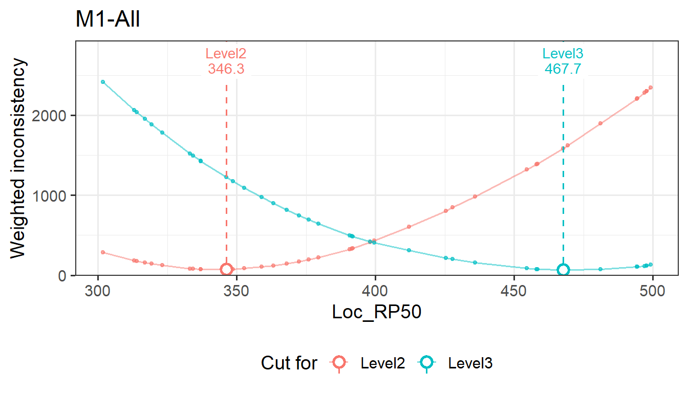
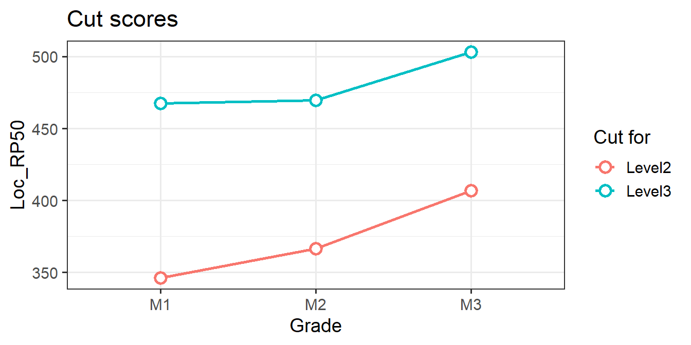
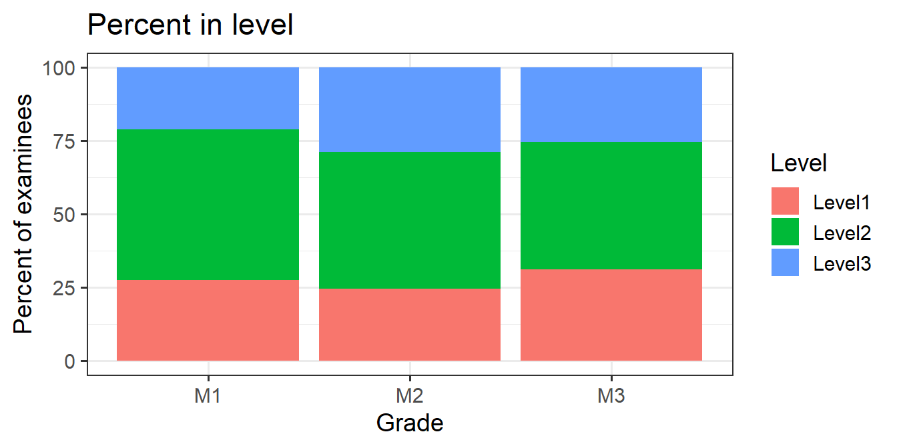

# Getting started with emss

`emss` estimates cut scores with **embedded standard setting** (ESS;
Lewis & Cook, 2020). Panelists align each item to the performance level
whose descriptor it matches. `emss` then places each cut score where the
items’ locations on the reporting scale agree best with those
alignments. This article covers the basic workflow. [How embedded
standard setting
works](https://sooyongl.github.io/emss/articles/ess-method.md) explains
what is computed and why, with a worked example and the underlying
mathematics.

## Installation

``` r
# install.packages("remotes")
remotes::install_github("sooyongl/emss")
```

``` r
library(emss)
```

## What `emss` needs

| Input | Required | One row per | Main columns |
|:---|:---|:---|:---|
| Ratings | yes | panelist × item (× round) | grade, panelist, item ID, aligned level; optional table and round |
| Items | yes | item | grade, item ID, one or more location columns (e.g., `RP67`); optional `Domain`, `Order_of_Difficulty` |
| Setup | optional | grade | `Level Options` (level labels, lowest to highest), `SD`, `EC` |
| Examinee scores | optional | grade × score | grade, `Score`, `Freq` (long format), for impact data |

The example of data structure can be found below in a simulated study
section.

The location is each item’s position on the reporting scale, typically a
response-probability location such as RP67 (for more details, see [Item
Location](https://sooyongl.github.io/emss/articles/item-locations.md)).
The item table may hold several location columns. The `location`
argument of
[`emstans()`](https://sooyongl.github.io/emss/reference/emstans.md)
picks one.

## A simulated study

[`generateMockDataSet()`](https://sooyongl.github.io/emss/reference/generateMockDataSet.md)
simulates a complete study: here three grades, two tables of four
panelists each, 40 items per grade, three performance levels, and three
content domains.

``` r
set.seed(7)
sim <- generateMockDataSet(ngca = 3, ntable = 2, npanelist = 4, cor_val = 0.7, nlevel = 3,
                      sdinp = 1, ecinp = 0, n = 40, 300, 500,
                      domains = c("Number", "Algebra", "Geometry"))
names(sim)
#> [1] "setup"             "panelist"          "rating"            "item_data"        
#> [5] "examineedata_data"
head(sim$setup, 3)
#> # A tibble: 3 × 7
#>   GCA   `Content Area` `Grade Group` Number of Tables per Ro…¹ `Level Options`    SD    EC
#>   <chr> <chr>          <chr>         <chr>                     <chr>           <dbl> <dbl>
#> 1 M1    Math           1             2                         Level1, Level2…     1     0
#> 2 M2    Math           2             2                         Level1, Level2…     1     0
#> 3 M3    Math           3             2                         Level1, Level2…     1     0
#> # ℹ abbreviated name: ¹​`Number of Tables per Room`
head(sim$panelist, 4)
#> # A tibble: 4 × 3
#>   GCA   Panelist Table
#>   <chr> <chr>    <chr>
#> 1 M1    M1.T1.1  T1   
#> 2 M1    M1.T1.2  T1   
#> 3 M1    M1.T1.3  T1   
#> 4 M1    M1.T1.4  T1
head(sim$rating, 5)
#> # A tibble: 5 × 8
#>   GCA   Subject Grade Round Table Panelist Item_ID ALD   
#>   <chr> <chr>   <chr> <dbl> <chr> <chr>    <chr>   <chr> 
#> 1 M1    Math    1         1 T1    M1.T1.1  M1_1    Level1
#> 2 M1    Math    1         1 T1    M1.T1.1  M1_2    Level1
#> 3 M1    Math    1         1 T1    M1.T1.1  M1_3    Level2
#> 4 M1    Math    1         1 T1    M1.T1.1  M1_4    Level2
#> 5 M1    Math    1         1 T1    M1.T1.1  M1_5    Level2
head(sim$item_data, 5)
#> # A tibble: 5 × 7
#>   GCA   Domain   Item_ID Total_points Point Order_of_Difficulty Loc_RP50
#>   <chr> <chr>    <chr>          <dbl> <dbl>               <int>    <dbl>
#> 1 M1    Number   M1_1               1     1                   1     302.
#> 2 M1    Geometry M1_2               1     1                   2     313.
#> 3 M1    Algebra  M1_3               1     1                   3     314.
#> 4 M1    Geometry M1_4               1     1                   4     317.
#> 5 M1    Number   M1_5               1     1                   5     319.
head(sim$examineedata_data, 10)
#> # A tibble: 10 × 3
#>    score  freq Grade
#>    <int> <int> <chr>
#>  1   286     4 M1   
#>  2   287     4 M1   
#>  3   288     6 M1   
#>  4   289     6 M1   
#>  5   290     7 M1   
#>  6   291     6 M1   
#>  7   292     3 M1   
#>  8   293     6 M1   
#>  9   294     1 M1   
#> 10   295     4 M1
```

`sdinp` (SD in the `sim$setup`) and `ecinp` (EC in the `sim$setup`) must
be named here: the unnamed values that follow `n` (300 and 500) are the
range of the item locations.

## Estimating cut scores

``` r
res <- emstans(data = sim, location = "Loc_RP50")
res
#> Embedded Standard Setting
#>   method: ESS-Weight | location: Loc_RP50 | 3 unit(s)
#> 
#> Modal cut scores (all tables):
#>   M1-All         Level2  346.300   Level3  467.700
#>   M2-All         Level2  366.600   Level3  469.600
#>   M3-All         Level2  406.800   Level3  503.300
#> 
#> Use extract() for tables, report() for the full report.
```

Each grade is analysed separately. For each one, `emss` estimates a cut
score for every panelist and for the **modal** alignment across
panelists, per table and for all tables together. The printed cut scores
are the modal cuts for all tables. Each cut is named by the level it
opens: `Level2` is the lowest score in Level 2.

The main options are:

| Argument | Values |
|:---|:---|
| `location` | name of the item location column, such as `"RP67"` |
| `method` | `"weight"` (ESS-Weight, default) or `"count"` (ESS-Count) |
| `grades` | grades to analyse, by name or position (default: all) |
| `by_domain`, `domains` | also analyse each content domain, or the listed ones |
| `smooth` | `TRUE` to take cuts from a GAM-smoothed inconsistency profile |

## Results

[`summary()`](https://rdrr.io/r/base/summary.html) puts the modal cut
next to the median and average of the panelists’ cuts, and adds the
agreement between aligned and empirical levels:

``` r
summary(res)
#>     unit cut_level modal median average agreement weighted_kappa
#> 1 M1-All    Level2 346.3 347.50  347.59     0.825          0.810
#> 2 M1-All    Level3 467.7 458.25  455.90     0.825          0.810
#> 3 M2-All    Level2 366.6 368.60  371.79     0.850          0.840
#> 4 M2-All    Level3 469.6 437.45  446.98     0.850          0.840
#> 5 M3-All    Level2 406.8 410.10  407.35     0.800          0.789
#> 6 M3-All    Level3 503.3 509.90  503.06     0.800          0.789
```

[`extract()`](https://sooyongl.github.io/emss/reference/extract.ESS.md)
returns the results as data frames, with level labels as ordered
factors:

``` r
extract(res, "cutscore")                    # modal cut scores, one vector per unit
#> $`M1-All`
#> Level2 Level3 
#>  346.3  467.7 
#> 
#> $`M2-All`
#> Level2 Level3 
#>  366.6  469.6 
#> 
#> $`M3-All`
#> Level2 Level3 
#>  406.8  503.3
ind <- extract(res, "individual")           # panelist, modal, median, average
head(ind$panelist[, c("unit", "table", "panelist", "correlation", "cut_level",
                      "page", "cut_score")])
#>      unit table panelist correlation cut_level page cut_score
#> 1  M1-All    T1  M1.T1.1      0.5824    Level2   12     348.7
#> 3  M1-All    T1  M1.T1.2      0.5708    Level2   15     363.3
#> 5  M1-All    T1  M1.T1.3      0.7180    Level2   11     346.3
#> 7  M1-All    T1  M1.T1.4      0.7042    Level2    6     323.1
#> 9  M1-All    T2  M1.T2.1      0.6059    Level2   13     352.7
#> 11 M1-All    T2  M1.T2.2      0.6565    Level2   15     363.3
extract(res, "detailed")$agreement          # agreement and weighted kappa
#>     unit  type  n agree disagree adjacent discrepant weighted_kappa
#> 1 M1-All exact 40    33        7        7          0         0.8103
#> 2 M1-All    ec 40    33        7        7          0         0.8103
#> 3 M2-All exact 40    34        6        6          0         0.8402
#> 4 M2-All    ec 40    34        6        6          0         0.8402
#> 5 M3-All exact 40    32        8        8          0         0.7886
#> 6 M3-All    ec 40    32        8        8          0         0.7886
im <- extract(res, "summary")               # impact data
im[im$unit == "M1-All", ]
#>     unit  level page_from page_to cut_score pct_in pct_at_above pct_below
#> 1 M1-All Level1         1      10        NA   27.5        100.0        NA
#> 2 M1-All Level2        11      31     346.3   51.3         72.5      27.5
#> 3 M1-All Level3        32      40     467.7   21.2         21.2      78.8
rv <- extract(res, "review")                # items whose alignment disagrees with the cuts
head(rv[rv$status != "Consistent", c("unit", "item_id", "aligned", "operational",
                                     "location", "distance", "status")])
#>      unit item_id aligned operational location distance       status
#> 3  M1-All    M1_3  Level2      Level1    313.9    -32.4 Inconsistent
#> 4  M1-All    M1_4  Level2      Level1    316.9    -29.4 Inconsistent
#> 11 M1-All   M1_11  Level1      Level2    346.3      1.0 Inconsistent
#> 14 M1-All   M1_14  Level1      Level2    359.0     13.7 Inconsistent
#> 31 M1-All   M1_31  Level3      Level2    458.4     -9.3 Inconsistent
#> 36 M1-All   M1_36  Level2      Level3    494.4     27.7 Inconsistent
```

Other options are `"profile"` (the inconsistency profile of each unit)
and `"all"`.

## Plots

The inconsistency profile shows, for every candidate cut, how
inconsistent the items would be. The selected cuts are at the minima:

``` r
plot(res, "profile", unit = "M1-All")
```



The impact plots show cut scores and examinee percentages across grades:

``` r
p <- plot(res, "impact")
names(p)
#> [1] "cut_scores"       "percent_in"       "percent_at_above"
p$cut_scores
```



``` r
p$percent_in
```



Both are ggplot objects and can be modified with the usual ggplot2
functions.

## Report

[`report()`](https://sooyongl.github.io/emss/reference/report.ESS.md)
builds an interactive HTML report with every table and plot, sections
for individual cuts, agreement, impact and item review:

``` r
report(res)                       # opens in the viewer
report(res, what = "review")      # one section only
```

## More analyses

``` r
# ESS-Count instead of ESS-Weight
emstans(data = sim, location = "Loc_RP50", method = "count")
#> Embedded Standard Setting
#>   method: ESS-Count | location: Loc_RP50 | 3 unit(s)
#> 
#> Modal cut scores (all tables):
#>   M1-All         Level2  348.700   Level3  458.400
#>   M2-All         Level2  366.600   Level3  475.200
#>   M3-All         Level2  415.800   Level3  481.900
#> 
#> Use extract() for tables, report() for the full report.

# Each content domain as well as all items, for grade M1 only
res_dom <- emstans(data = sim, location = "Loc_RP50", grades = "M1", by_domain = TRUE)
extract(res_dom, "cutscore")
#> $`M1-All`
#> Level2 Level3 
#>  346.3  467.7 
#> 
#> $`M1-Algebra`
#> Level2 Level3 
#>  337.1  494.2 
#> 
#> $`M1-Geometry`
#> Level2 Level3 
#>  348.7  458.4 
#> 
#> $`M1-Number`
#> Level2 Level3 
#>  372.4  497.7
```

When the ratings contain several rounds, each round is analysed
separately and named accordingly, for example `M1-All Round 2`.

## Your own data

An EmStanS Excel workbook (sheets Setup, Panelists, Ratings,
ItemMetaData, ExamineeMetaData) can be passed directly:

``` r
res <- emstans("my_study.xlsx", location = "RP67")
```

Data frames or CSV files with other layouts go through
[`ess_data()`](https://sooyongl.github.io/emss/reference/ess_data.md).
Only ratings and items are required. Level labels, SD and EC can come
from a setup table, from arguments, or both (arguments win). Columns
whose names differ from the defaults are mapped by name or position:

``` r
d <- ess_data(
  ratings   = "ratings.csv",
  items     = "items.csv",
  examinees = "scores.csv",                            # Grade, Score, Freq
  levels    = c("Basic", "Proficient", "Advanced"),    # lowest to highest
  sd        = 30,
  ec        = 5,
  columns   = list(ratings = list(panelist = "Rater", level = "Judgment"))
)
d                                  # what was read
res <- emstans(data = d, location = "RP67")
```

Level labels can also differ by grade, for example
`levels = list(G4 = c("E", "M", "L"), G5 = c("B", "P", "A"))`. Every
table, plot and report uses the labels, in level order.

## Next steps

- [How embedded standard setting
  works](https://sooyongl.github.io/emss/articles/ess-method.md):
  ESS-Count and ESS-Weight with a worked example, and the mathematics
  behind each result.
- [Setting cut scores
  manually](https://sooyongl.github.io/emss/articles/manual-cut-scores.md):
  evaluate cut scores you set yourself.
- [Bootstrapping cut
  scores](https://sooyongl.github.io/emss/articles/bootstrapping.md):
  the sampling variability of cut scores.
- [Computation of Item
  Location](https://sooyongl.github.io/emss/articles/item-locations.md):
  Computing item locations according to IRT models.

## References

Lewis, D., & Cook, R. (2020). Embedded standard setting: Aligning
standard-setting methodology with contemporary assessment design
principles. *Educational Measurement: Issues and Practice, 39*(1), 8–21.
https://doi.org/10.1111/emip.12318
