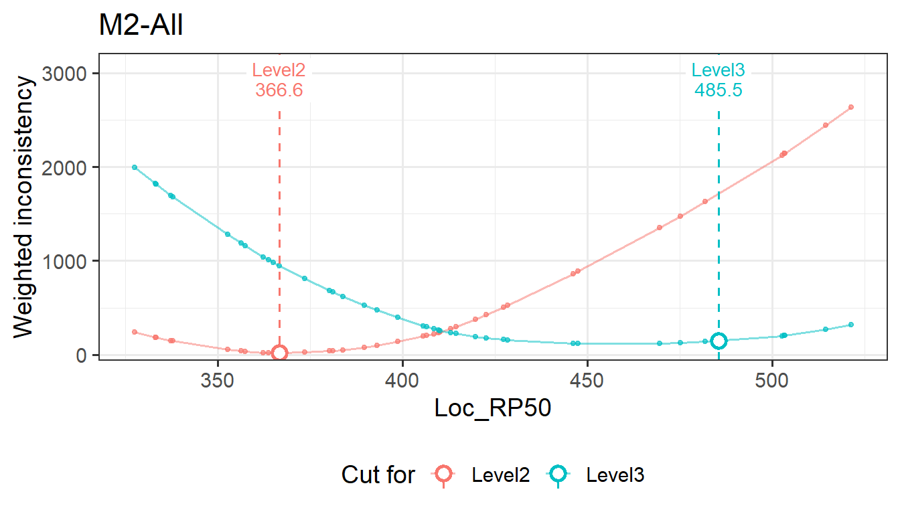

# Setting cut scores manually

The ESS cut scores are a recommendation. A policy body may adjust them:
to make cuts progress smoothly across grades, to adopt the panelists’
median instead of the modal cut, or to try a proposed value.
[`update()`](https://rdrr.io/r/stats/update.html) replaces the modal cut
scores of one or more units with values you give, and recomputes
everything that depends on them. You can then compare the consistency
and impact of the manual cuts with those of the estimated ones.

The notation follows [How embedded standard setting
works](https://sooyongl.github.io/emss/articles/ess-method.md).

## 1 The study

The simulated study from [Getting
started](https://sooyongl.github.io/emss/articles/getting-started.md):
three grades, two tables of four panelists, 40 items per grade, and
three levels.

``` r
set.seed(7)
sim <- generateMockDataSet(ngca = 3, ntable = 2, npanelist = 4, cor_val = 0.7, nlevel = 3,
                      sdinp = 1, ecinp = 0, n = 40, 300, 500,
                      domains = c("Number", "Algebra", "Geometry"))
res <- emstans(data = sim, location = "Loc_RP50")
res
#> Embedded Standard Setting
#>   method: ESS-Weight | location: Loc_RP50 | 3 unit(s)
#> 
#> Modal cut scores (all tables):
#>   M1-All         Level2  346.300   Level3  467.700
#>   M2-All         Level2  366.600   Level3  469.600
#>   M3-All         Level2  406.800   Level3  503.300
#> 
#> Use extract() for tables, report() for the full report.
```

The Level3 cut barely rises from M1 to M2 (467.7 and 469.6) and then
jumps for M3 (503.3). A committee might prefer a smoother progression,
with the M2 cut halfway between M1 and M3.

## 2 Using `update()`

Give one numeric vector per unit, named as in
`extract(res, "cutscore")`, with one cut score per cut level, in
increasing order:

``` r
mid <- mean(c(extract(res, "cutscore")[["M1-All"]][2], extract(res, "cutscore")[["M3-All"]][2]))
mid
#> [1] 485.5
res_man <- update(res, `M2-All` = c(366.6, mid))
res_man
#> Embedded Standard Setting
#>   method: ESS-Weight | location: Loc_RP50 | 3 unit(s) | manual cuts: M2-All
#> 
#> Modal cut scores (all tables):
#>   M1-All         Level2  346.300   Level3  467.700
#>   M2-All         Level2  366.600   Level3  485.500
#>   M3-All         Level2  406.800   Level3  503.300
#> 
#> Use extract() for tables, report() for the full report.
```

Several units can be updated in one call, in any order. Each unit needs
exactly \\K - 1\\ values. A unit name that doesn’t exist, the wrong
number of values, or a cut above every item location is an error. To go
back to the estimated cuts, use the original object or run
[`emstans()`](https://sooyongl.github.io/emss/reference/emstans.md)
again.

## 3 What is recomputed

For a unit with manual cuts \\\tilde c_2, \dots, \tilde c_K\\:

1.  **Pages.** Each cut is placed before the first item at or above it:
    \\\tilde p_k = \min\\\\ p : b\_{(p)} \ge \tilde c_k \\\\\\.
2.  **Count and Weight.** Both are evaluated at the cut score itself,
    \\C_k(\tilde c_k)\\ and \\W_k(\tilde c_k)\\. The count equals that
    of page \\\tilde p_k\\, because no item lies between \\b\_{(\tilde
    p_k - 1)}\\ and \\\tilde c_k\\. The weight is lower than at
    \\b\_{(\tilde p_k)}\\ whenever the profile is still falling there,
    since \\W_k\\ is linear between item locations with slope \\(p -
    n\_{\<k})/\sigma\\ after page \\p\\: \\ W_k(\tilde c_k) =
    W_k\big(b\_{(\tilde p_k)}\big) - \frac{(\tilde p_k - 1 -
    n\_{\<k})\\\big(b\_{(\tilde p_k)} - \tilde c_k\big)}{\sigma}. \\
3.  **Empirical levels** \\o_i = 1 + \\\\\\ k : \tilde c_k \le b_i
    \\\\\\, and from them the agreement, the crosstabs, the item review
    and the impact data.

The panelist cuts, the per-table modal cuts, the median and average
cuts, and the inconsistency profiles stay as estimated. They describe
the panelists’ judgements, which a manual cut does not change.

``` r
modal_all <- function(x, unit) {
  m <- x$modal[x$modal$unit == unit & x$modal$table == "All", ]
  m[, c("level", "page", "cut_score", "count", "weight")]
}
modal_all(res, "M2-All")
#>    level page cut_score count weight
#> 11     2   12     366.6     2   16.6
#> 12     3   33     469.6     4  119.0
modal_all(res_man, "M2-All")
#>    level page cut_score count weight
#> 11     2   12     366.6     2   16.6
#> 12     3   36     485.5     3  148.8
```

The manual Level3 cut lies between two items. Its weight is below the
weight at the next item’s location, as the formula in step 2 says:

``` r
u <- res$units[["M2-All"]]
a <- res$modal_items$aligned[res$modal_items$unit == "M2-All"]
p <- which(u$location >= mid)[1]
prof <- extract(res, "profile")[["M2-All"]]
prof[p, "Level3 weight"] - (p - 1 - sum(a < 3)) * (u$location[p] - mid) / u$sd
#> [1] 148.8
```

## 4 The cost of a manual cut

The estimated cut minimizes the chosen criterion, so for the same
criterion a manual cut can only add inconsistency:

\\ \Delta W_k = W_k(\tilde c_k) - W_k(\hat c_k) \ge 0, \qquad \Delta C_k
= C_k(\tilde c_k) - C_k(\hat c_k) \ge 0 \\

under ESS-Weight and ESS-Count respectively. The other criterion can
move either way. Here the manual Level3 cut has a larger weight, which
ESS-Weight minimizes, but a smaller count:

``` r
cbind(estimated = modal_all(res, "M2-All")[2, c("count", "weight")],
      manual    = modal_all(res_man, "M2-All")[2, c("count", "weight")])
#>    estimated.count estimated.weight manual.count manual.weight
#> 12               4              119            3         148.8
```

The profile plot marks the manual cut on the profile:

``` r
plot(res_man, "profile", unit = "M2-All")
```



Because the cuts are ordered, the counts add up to the total level
disagreement, \\\sum_k C_k(\tilde c_k) = \sum_i \lvert a_i - o_i
\rvert\\ (see [What the minimum values add up
to](https://sooyongl.github.io/emss/articles/ess-method.html#sec-totals)).
Fewer inconsistent items therefore means higher agreement:

``` r
ag <- function(x) {
  s <- extract(x, "detailed")$agreement
  s[s$unit == "M2-All" & s$type == "exact", c("agree", "disagree", "weighted_kappa")]
}
rbind(estimated = ag(res), manual = ag(res_man))
#>           agree disagree weighted_kappa
#> estimated    34        6         0.8402
#> manual       35        5         0.8534
```

This is not a contradiction. ESS-Weight puts the cut so that the number
of items below it matches the number aligned below the level, which need
not minimize the number of misplaced items (see [ESS-Weight is a
quantile of the item
locations](https://sooyongl.github.io/emss/articles/ess-method.html#sec-quantile)).

## 5 Impact and item review

Impact changes only for the levels on either side of the changed cut:

``` r
imp <- function(x) {
  s <- extract(x, "summary")
  s[s$unit == "M2-All", c("level", "page_from", "page_to", "cut_score", "pct_in", "pct_at_above")]
}
imp(res)
#>    level page_from page_to cut_score pct_in pct_at_above
#> 4 Level1         1      11        NA   24.5        100.0
#> 5 Level2        12      32     366.6   46.6         75.5
#> 6 Level3        33      40     469.6   28.8         28.8
imp(res_man)
#>    level page_from page_to cut_score pct_in pct_at_above
#> 4 Level1         1      11        NA   24.5        100.0
#> 5 Level2        12      35     366.6   53.4         75.5
#> 6 Level3        36      40     485.5   22.1         22.1
```

The item review lists the items that the manual cuts place outside their
aligned level:

``` r
rv <- extract(res_man, "review")
rv[rv$unit == "M2-All" & rv$status != "Consistent",
   c("item_id", "page", "aligned", "operational", "location", "distance", "status")]
#>    item_id page aligned operational location distance       status
#> 50   M2_10   10  Level2      Level1    363.7     -2.9 Inconsistent
#> 54   M2_14   14  Level1      Level2    380.3     14.7 Inconsistent
#> 63   M2_23   23  Level3      Level2    409.8    -75.7 Inconsistent
#> 68   M2_28   28  Level3      Level2    422.7    -62.8 Inconsistent
#> 74   M2_34   34  Level3      Level2    475.2    -10.3 Inconsistent
```

`report(res_man)` shows all of this in the HTML report, with the manual
units named in its header.

## 6 Another common choice: the panelists’ median

Instead of the modal cut, a committee may adopt the median of the
panelists’ cuts:

``` r
md <- extract(res, "individual")$median
md <- md[md$table == "All", ]
med_cuts <- split(md$cut_score, md$unit)
med_cuts
#> $`M1-All`
#> [1] 347.5 458.2
#> 
#> $`M2-All`
#> [1] 368.6 437.4
#> 
#> $`M3-All`
#> [1] 410.1 509.9
res_med <- do.call(update, c(list(res), med_cuts))
summary(res_med)
#>     unit cut_level  modal median average agreement weighted_kappa
#> 1 M1-All    Level2 347.50 347.50  347.59     0.875          0.871
#> 2 M1-All    Level3 458.25 458.25  455.90     0.875          0.871
#> 3 M2-All    Level2 368.60 368.60  371.79     0.775          0.779
#> 4 M2-All    Level3 437.45 437.45  446.98     0.775          0.779
#> 5 M3-All    Level2 410.10 410.10  407.35     0.750          0.737
#> 6 M3-All    Level3 509.90 509.90  503.06     0.750          0.737
```

Here the modal and median columns show the same values, because the
modal cuts were replaced by the medians.
